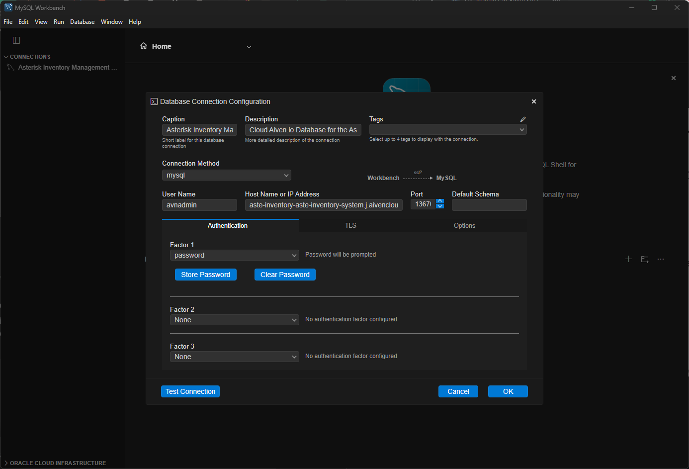

# Project Title

## Table of Contents

- [About](#about)
- [Getting Started](#getting_started)
- [Usage](#usage)

## About <a name = "about"></a>

Inventory Management System developed for Asterisko Artisan Coffee, featuring user logins and permissions, inventory logging, OCR scanning, etc. improve this shi

## Getting Started <a name = "getting_started"></a>

These instructions will get you a copy of the project up and running on your local machine for development and testing purposes. See [deployment](#deployment) for notes on how to deploy the project on a live system.

### Prerequisites
* GitHub
* VSCODE
* MySQL Workbench

### Installing
How to get to testing the project

#### Setting up the Live Server <a name = "server_setup"></a>
On VSCode, open your terminal using

```
Ctrl + Shift + P
```

Type the following line onto your command terminal,
```
php -S localhost:8000
```

#### Note:
If the term 'php' is not recognized, you can instead try to run, 
```
C:\xampp\php\php.exe -S localhost:8000
```
or add **C:\xampp\php** onto your Windows Environment PATH

#### Setting up the database
1. Open MySQL Workbench and click the plus icon to create a new connection
2. Enter the following credentials into the login page

   **User Name**
        
        avnadmin

    **Host Name or IP Address**

        aste-inventory-aste-inventory-system.j.aivencloud.com

    **Port**

        13670

3. Select password as Factor 1 and store the password below

    ```
    AVNS_5-LQ3ixBakUHi93eYVK
    ```

    #### It should look like this

    

4. Click OK
        

## Usage <a name = "usage"></a>

go to https://localhost:8000/login.php to start.

refer to [Setting up the Live Server](#setting-up-the-live-server)